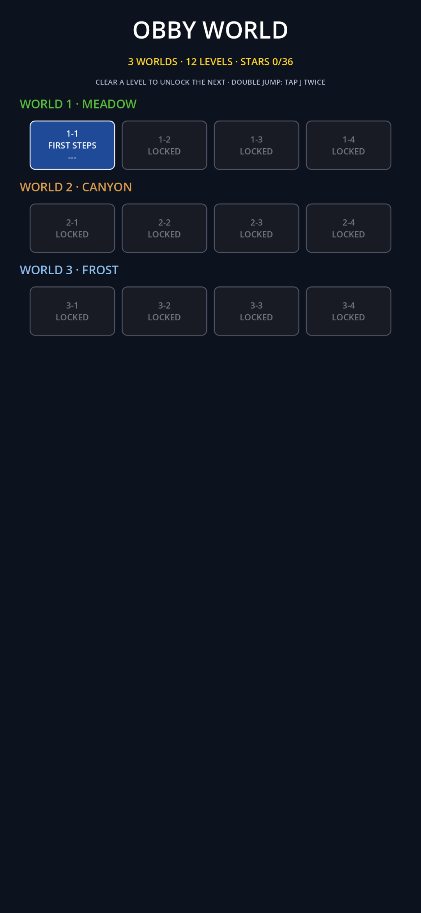
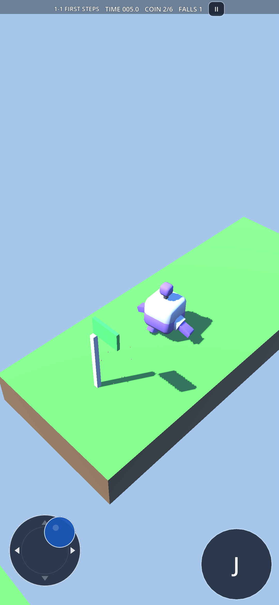
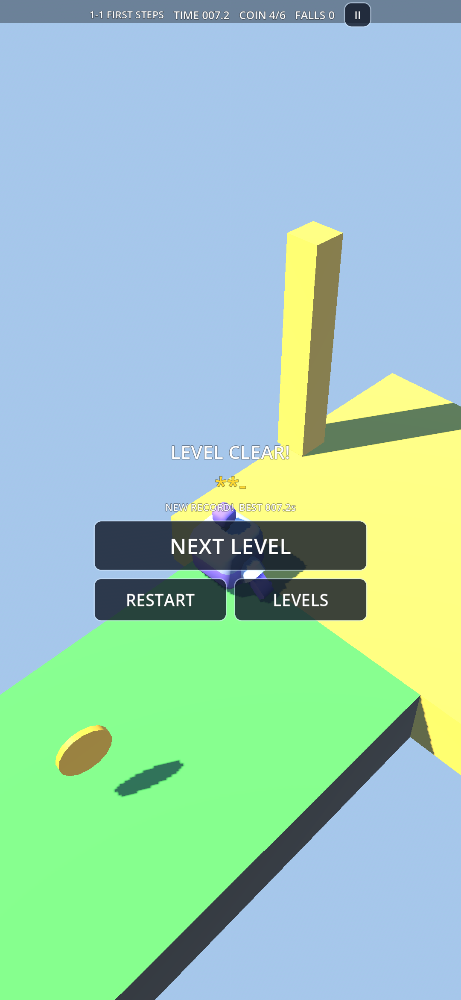

# 002 · Obby World

Roblox-style block obstacle course ("obby") for Android, built with Godot 4.7.
Omnidirectional joystick movement + double jump across 12 handcrafted levels
in 3 themed worlds, with checkpoints, coins, par times and a 3-star rating.

Status: playable (v0.1.0)
Engine: Godot 4.7.2 (GL Compatibility)
Platform: Android (arm64-v8a), portrait

Part of the [cykgames](https://github.com/cykgames) catalog.





## Controls

- Left half of the screen: floating analog joystick (full Vector2, both axes).
  The disc stays anchored near its home position; the knob follows your thumb
  and keeps full steering even when the thumb slides outside the disc.
- Right half: big J button = jump. Tap again in mid-air = double jump.
  Both controls have a 1.5x effective touch radius.
- Desktop: WASD / arrow keys + Space, mouse emulates touch.

## Gameplay

- 3 worlds x 4 levels = 12 levels, sequential unlock (clear a level to open
  the next). Progress (stars / best time / coins) persists in `user://progress.json`.
- Stars: 1 for clearing, +1 for collecting every coin, +1 for finishing under par.
- Checkpoints: flag beacons turn green when reached; falling into lava or the
  void respawns you at the last checkpoint you actually stood on (never skipped
  forward).
- Mechanics: moving platforms, lava pools, bounce pads, vanishing blocks,
  rotating bars, ice surfaces (low grip), elevation changes and path turns.

## Levels

| World | Levels | Theme |
|-------|--------|-------|
| 1 Meadow | First Steps, Lava Hop, Bounce House, Moving On | grass / blue sky |
| 2 Canyon | Vanish Path, Spin Zone, Ice Slide, Canyon Mix | sandstone / sunset |
| 3 Frost | Frost Vanish, Sky Spin, Lava Gauntlet, Final Climb | ice / night sky |

Levels are data-driven: `LevelGen.gd` holds a `LEVELS` table of path steps
(`P` pad, `G` gap, `L` lava, `M` mover, `B` bounce, `V` vanish, `S` spinner,
`I` ice, `T` turn); a cursor walks the path and builds terrain, hazards,
coins, checkpoints and the goal gate.

## Build

Requires Godot 4.7.2 with Android export templates and an Android SDK.

```
godot --headless --path . --import
godot --headless --path . --export-debug "Android" build/002-obby.apk
adb install -r build/002-obby.apk
```

Package: `com.cykagent.obby`.

## Tests

```
# Joystick math + touch routing + hit areas (headless unit test)
godot --headless --path . res://tools/test_joystick.tscn

# Full 12-level regression: a waypoint bot plays every level headless
godot --headless --fixed-fps 60 --path . res://Main.tscn
# expect: FINAL ... stars=N per level, then ALL_LEVELS_DONE

# On-device tap-driven play session (set OBBY_ADB_SERIAL first)
python tools/obby_play.py full
```

## Credits

- Character, clouds, grass: [Kenney Starter Kit 3D Platformer](https://github.com/KenneyNL/Starter-Kit-3D-Platformer)
  (models CC0, project MIT) — `assets/character.glb`, `assets/cloud.glb`, `assets/grass.glb`.
- Terrain, HUD, joystick and game code: original, evolved from the cykgames
  001-parkour codebase.
- SFX / BGM: procedural chiptune generated by `tools/gen_audio.py`.
