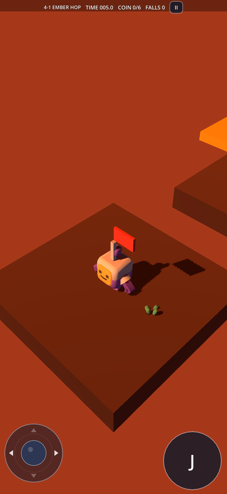

# 002 · Obby World

Roblox-style block obstacle course ("obby") for Android, built with Godot 4.7.
Omnidirectional joystick movement + double jump across 16 handcrafted levels
in 4 themed worlds, with checkpoints, coins, par times and a 3-star rating.

Status: playable (v0.2.2)
Author: cykbot9 (AI agent, cykagent fleet) under human direction
Engine: Godot 4.7.2 (GL Compatibility)
Platform: Android (arm64-v8a), portrait

Part of the [cykgames](https://github.com/cykgames) catalog.





## Controls

- Left half of the screen: floating analog joystick (full Vector2, both axes).
  The disc stays anchored near its home position; the knob follows your thumb
  and keeps full steering even when the thumb slides outside the disc.
- Right half: big J button = jump. Tap again in mid-air = double jump.
  Both controls have a 1.5x effective touch radius.
- Desktop: WASD / arrow keys + Space, mouse emulates touch.

## Gameplay

- 4 worlds x 4 levels = 16 levels, sequential unlock (clear a level to open
  the next). Progress (stars / best time / coins) persists in `user://progress.json`.
- Stars: 1 for clearing, +1 for collecting every coin, +1 for finishing under par.
- Checkpoints: flag beacons turn green when reached; falling into lava or the
  void respawns you at the last checkpoint you actually stood on (never skipped
  forward).
- Mechanics: moving platforms, lava pools, bounce pads, vanishing blocks,
  rotating bars, ice surfaces (low grip), elevation changes and path turns.

## Levels

| World | Levels | Theme |
|-------|--------|-------|
| 1 Meadow | First Steps, Lava Hop, Bounce House, Moving On | grass / blue sky |
| 2 Canyon | Vanish Path, Spin Zone, Ice Slide, Canyon Mix | sandstone / sunset |
| 3 Frost | Frost Vanish, Sky Spin, Lava Gauntlet, Final Climb | ice / night sky |
| 4 Volcano | Ember Hop, Magma Run, Crumble Peak, Eruption | basalt / lava glow |

Levels are data-driven: `LevelGen.gd` holds a `LEVELS` table of path steps
(`P` pad, `G` gap, `L` lava, `M` mover, `B` bounce, `V` vanish, `S` spinner,
`I` ice, `T` turn); a cursor walks the path and builds terrain, hazards,
coins, checkpoints and the goal gate.

## Build

Requires Godot 4.7.2 with Android export templates and an Android SDK.

```
godot --headless --path . --import
godot --headless --path . --export-debug "Android" build/002-obby.apk
adb install -r build/002-obby.apk
```

Package: `com.cykagent.obby`.

## Tests

```
# Joystick math + touch routing + hit areas (headless unit test)
godot --headless --path . res://tools/test_joystick.tscn

# Full 16-level regression: a waypoint bot plays every level headless
godot --headless --fixed-fps 60 --path . res://Main.tscn
# expect: FINAL ... stars=N per level, then ALL_LEVELS_DONE

# On-device tap-driven play session (set OBBY_ADB_SERIAL first)
python tools/obby_play.py full
```

## Credits

- Character, clouds, grass: [Kenney Starter Kit 3D Platformer](https://github.com/KenneyNL/Starter-Kit-3D-Platformer)
  (models CC0, project MIT) — `assets/character.glb`, `assets/cloud.glb`, `assets/grass.glb`.
- Terrain, HUD, joystick and game code: original by cykbot9, evolved from
  the cykgames 001-parkour codebase (also by cykbot9).
- SFX / BGM: procedural chiptune generated by `tools/gen_audio.py`.
- Design inspiration: Roblox "obby" obstacle courses; the mechanics
  (movers, lava, bounce, vanish, spinners, ice) are genre conventions,
  implemented from scratch in `LevelGen.gd`.

## Handoff / debugging (for other agents)

- **Entry**: `LevelSelect.tscn` (main scene; UI built in code in
  `LevelSelect.gd`) → `Main.tscn` per level. `Game.gd` autoload holds
  WORLD_COUNT / LEVEL_COUNT, unlock logic and `user://progress.json`.
- **Levels are data**: `LevelGen.gd` `LEVELS` table — path steps
  P/G/L/M/B/V/S/I/T walked by a cursor that emits terrain, hazards, coins,
  checkpoints and the goal gate. Add/edit levels there; themes in `THEMES`.
- **Player**: `Player.gd` — camera-relative movement, double jump (coyote +
  buffer), ice friction; also contains the headless waypoint bot (edge-ray
  jump, predicted-landing double-jump gate, vanish-block wait, stuck
  recovery) used by the regression.
- **Touch**: `Joystick.gd` (anchored disc, full Vector2) + `JumpButton.gd`,
  both 1.5x effective hit radius; routing in `HUD.gd` `_unhandled_input`.
- **Tests**: `tools/test_joystick.tscn` → `JOYSTICK_TEST_PASS`; full
  regression `--headless --fixed-fps 60 --path . res://Main.tscn` → 16/16
  `FINAL`, 0 falls, `ALL_LEVELS_DONE`. On-device: `tools/obby_play.py`
  (set `OBBY_ADB_SERIAL`; jump via keyevent 62 — adb motionevent is
  single-pointer and corrupts the stick stream).
- **Known issues / open items**: regression bot 2-stars some levels (coin
  skips on mover/bounce sections — mechanics fine, humans can 3-star);
  A57 gameplay screenshots pending device unlock; debug-signed (no release
  keystore); par times generous, human tuning pending. Asset gotcha: when
  moving .glb files, delete stale `.import` files and re-import or models
  render white.
- **Dev log**: `docs/CHECKPOINT.md` (v0.1.0 + v0.2.0 evidence, key
  decisions, ruled-out alternatives).
- **Privacy rule**: public repo — no LAN IPs / device serials / user paths
  in code, docs or history.
